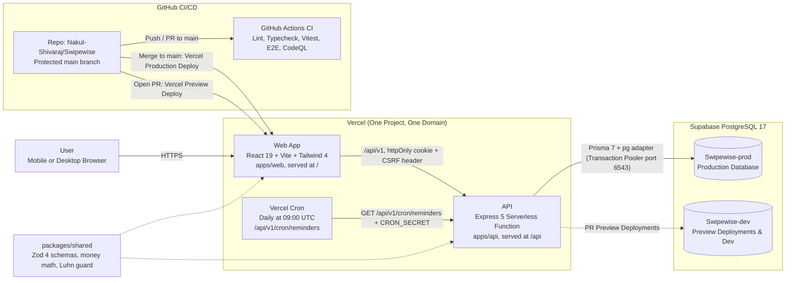
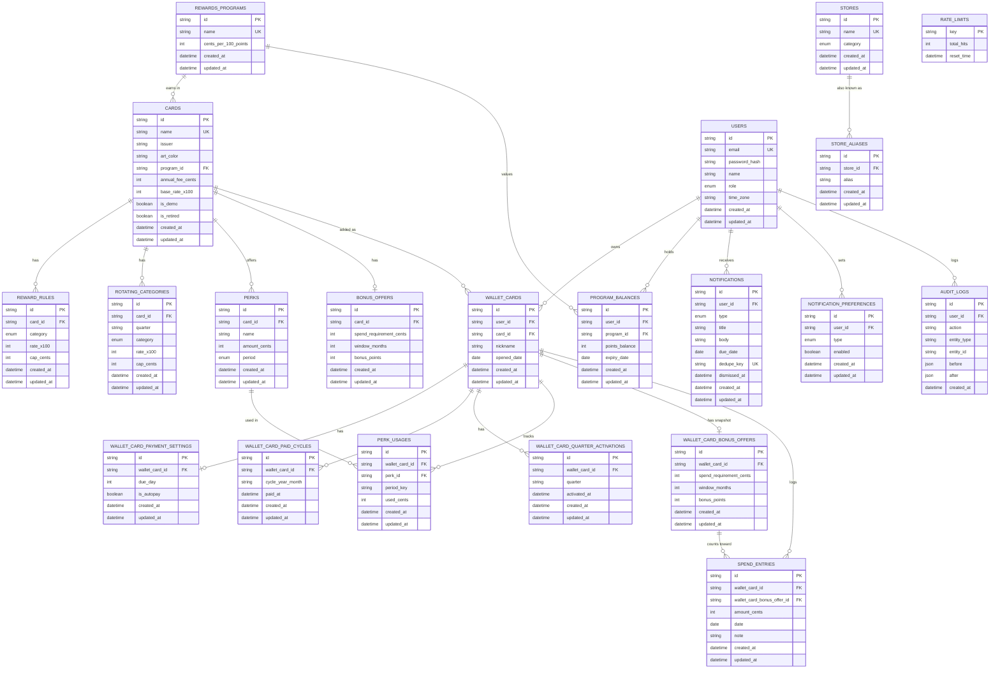

# SwipeWise

> A private credit card wallet that maximizes card rewards and prevents perks, bonuses, points, and payments from slipping through the cracks. Never moves money and never stores full card numbers.

**Live Application:** [https://swipewise-brown.vercel.app](https://swipewise-brown.vercel.app)

<!-- Demo video: add the link here when it's ready -->

---

## Table of Contents

1. [Overview & Core Features](#overview--core-features)
2. [Tech Stack](#tech-stack)
3. [Architecture](#architecture)
   - [System Architecture](#system-architecture)
   - [Database Schema (ERD)](#database-schema-erd)
4. [API & OpenAPI Documentation](#api--openapi-documentation)
   - [Public Endpoints](#public-endpoints)
   - [Earlier Public Endpoints (#26)](#earlier-public-endpoints-26)
5. [Local setup](#local-setup)
   - [Prerequisites](#prerequisites)
   - [Installation & Configuration](#installation--configuration)
   - [Environment Variables](#environment-variables)
   - [Main NPM Scripts](#main-npm-scripts)
6. [Testing & Quality Assurance](#testing--quality-assurance)
   - [Unit Testing](#unit-testing)
   - [Integration Testing](#integration-testing)
   - [End-to-End (E2E) Testing](#end-to-end-e2e-testing)
   - [Continuous Integration (CI) Pipeline](#continuous-integration-ci-pipeline)
7. [Deployment & Operations](#deployment--operations)
   - [Hosting & Infrastructure](#hosting--infrastructure)
   - [Database Migrations & Seeding Strategy](#database-migrations--seeding-strategy)
   - [Admin User Promotion](#admin-user-promotion)
8. [Security Architecture](#security-architecture)
   - [Password Hashing (Argon2id)](#password-hashing-argon2id)
   - [Authentication & httpOnly Cookies](#authentication--httponly-cookies)
   - [Cross-Site Request Forgery (CSRF) Protection](#cross-site-request-forgery-csrf-protection)
   - [PostgreSQL-Backed Distributed Rate Limiting](#postgresql-backed-distributed-rate-limiting)
   - [Card-Number Guard (Luhn Validation)](#card-number-guard-luhn-validation)
   - [Transactional Audit Logging](#transactional-audit-logging)
9. [Known Limitations](#known-limitations)
10. [Project Status & Future Work](#project-status--future-work)
11. [Contribution Log](#contribution-log)

---

## Overview & Core Features

People with multiple credit cards often use the wrong card, forget recurring statement perks, miss rotating category activations, let points expire, or miss payment due dates. SwipeWise solves this by serving as an intelligent, private wallet optimizer:

- **Smart Card Recommendations by Category:** Recommends the highest-earning wallet card for Groceries, Dining, Gas, or Travel. All calculations are executed on the server in whole integer cents using card base rates, category reward rules, and program valuations (`amountCents × rateX100 × centsPer100Points / 1_000_000`).
- **Store Search & Auto-Categorization:** Real-time search with store alias mapping (e.g., "Trader Joe’s", "Whole Foods", "Shell") that resolves merchant names to spending categories and recommends the optimal card.
- **Wallet Management:** Browse the demo card catalog, add cards to a personal wallet, configure custom card nicknames, and record card opened dates.
- **5% Rotating Categories & Quarter Activations:** Track quarterly 5% bonus categories (e.g., Q4 Gas, Q1 Groceries) and log quarter activations for cards with rotating categories (such as Orbit Quarterly).
- **Perks Tracker:** Track recurring statement credits (Monthly, Quarterly, Semiannual, Annual) across wallet cards, record used amounts in whole cents, and receive automated reminders 5 days before a perk period closes.
- **Sign-Up Bonus Tracker:** Monitor welcome bonus spending requirements within designated time windows (e.g., spend $3,000 in 3 months for 60,000 bonus points) with custom spend entries and progress tracking.
- **Payment Due Reminders & Cycle Tracking:** Configure card due dates and autopay settings, track paid statement cycles (`YYYY-MM`), and receive notifications before payment deadlines.
- **Points Balances & Expiry Alerts:** Manage reward program point balances across issuers and receive alerts ahead of points expiration dates.
- **In-App Notification Center:** Automated daily reminder processing via Vercel Cron (`0 9 * * *`) that generates deduplicated in-app alerts across payment due dates, ending perks, rotating category activations, and expiring points.
- **Admin Console & Catalog Management:** Dedicated admin dashboard (`/admin`) for creating cards, stores, and aliases, retiring cards safely without breaking existing user wallets, reviewing transactional audit logs, and promoting users via CLI.
- **Public API (post-sprint):** Read-only endpoints for the demo catalog, categories, store search, and best-card rankings, documented with an interactive Swagger UI at `/api/docs`. Never returns user data.
- **Responsive Liquid Glass UI:** iOS-style Liquid Glass aesthetic built with Tailwind CSS 4, offering adaptive layouts for mobile viewports (floating glass tab bar) and desktop screens (sticky glass top navigation and open tables).

---

## Tech Stack

| Layer            | Technology                                | Details                                                                                         |
| ---------------- | ----------------------------------------- | ----------------------------------------------------------------------------------------------- |
| **Frontend**     | React 19, Vite 6, TypeScript 5.7          | Strict TypeScript (no `any`), TanStack Query 5, React Router 8, React Hook Form 7, Lucide React |
| **Styling**      | Tailwind CSS 4                            | Custom tokens derived from `docs/DESIGN.md`, responsive mobile & desktop layouts                |
| **Backend**      | Node.js 24 LTS, Express 5, TypeScript 5.7 | Clean architecture: Routes → Controllers → Services → Domain (pure) + Repositories              |
| **Shared**       | `@swipewise/shared` (TypeScript 5.7)      | Shared Zod 4 schemas, money integer math utilities, Luhn card-number validators                 |
| **Database**     | PostgreSQL 17, Prisma ORM 7               | `@prisma/client`, `@prisma/adapter-pg`, hosted on Supabase with PgBouncer transaction pooling   |
| **Security**     | Argon2id, Jose (JWT), CSRF-CSRF, Helmet   | `httpOnly` secure cookies, double-submit CSRF, Postgres-backed rate limiting                    |
| **Dates & Time** | Luxon                                     | IANA time zone support, pure calendar and quarter date math in user time zones                  |
| **Testing**      | Vitest 3, Supertest 7, Playwright 1.64    | Vitest for unit & integration tests; Playwright for cross-device E2E browser tests              |
| **CI / CD**      | GitHub Actions, Vercel                    | Automated lint, typecheck, migrations, tests, security audit, CodeQL, and Vercel deploys        |

---

## Architecture

SwipeWise is structured as a TypeScript monorepo containing `apps/web` (React client), `apps/api` (Express backend), and `packages/shared` (shared validation and domain utilities). The diagrams below are also in [docs/architecture.md](docs/architecture.md).

### System Architecture



### Database Schema (ERD)

The database schema is managed through Prisma ORM (`apps/api/prisma/schema.prisma`) against PostgreSQL 17. Money values are stored as whole integer cents (`*_cents`), earn rates as points per dollar × 100 (`rate_x100`), and timestamps in UTC.



---

## API & OpenAPI Documentation

SwipeWise provides an interactive OpenAPI 3.0 specification generated dynamically from shared Zod schemas using `@asteasolutions/zod-to-openapi`.

- **Interactive Swagger UI:** [`/api/docs`](https://swipewise-brown.vercel.app/api/docs) — Interactive API explorer documenting both public routes and authenticated wallet endpoints.
- **OpenAPI JSON Specification:** [`/api/openapi.json`](https://swipewise-brown.vercel.app/api/openapi.json)
- **Committed Specification:** [`docs/api/openapi.yaml`](docs/api/openapi.yaml) (validated via automated tests to prevent schema drift)

### Public Endpoints

SwipeWise exposes a dedicated public, read-only API under `/api/public/v1/*` that external applications can access without authentication or login cookies:

- `GET /api/public/v1/cards` — Returns all active catalog credit cards (non-retired), including card name, issuer, annual fee, base rate, and reward rules.
- `GET /api/public/v1/categories` — Returns the list of supported reward spend categories (`GROCERIES`, `DINING`, `GAS`, `TRAVEL`).
- `GET /api/public/v1/stores?query=saf` — Searches store directory and aliases case-insensitively and maps merchants to their spend categories.
- `GET /api/public/v1/best-card?category=GROCERIES&amountCents=10000` — Evaluates and ranks catalog credit cards by rewards earned for a purchase category and amount in integer cents, with an optional `cardIds` parameter to filter rankings to specific cards.

#### Public API Controls & Security

1. **Zero User Data:** Public endpoints never return user wallet or profile information, never read authentication cookies, and reject card-number input (via Luhn validation guard).
2. **Dedicated Rate Limiting:** Backed by PostgreSQL (`PostgresRateLimitStore`), keyed by client IP, and isolated so public traffic never exhausts authenticated user limits.
3. **CORS:** Open to any origin (`Access-Control-Allow-Origin: *`) specifically on `/api/public/*` routes, while internal `/api/v1/*` routes remain restricted to the frontend client origin.

### Earlier Public Endpoints (#26)

**Deprecated.** The first version of the public API (#26, PR #58) is still live under `/api/v1/public/*` for compatibility; new integrations should use the v1 endpoints above. It follows the same rules: no login, no user data, card-number input rejected with `400`, and the same dedicated rate limit. It has its own OpenAPI document at `/api/v1/public/openapi.json`. Merging the two versions is listed under [Future Work](#future-work).

| Endpoint                             | Returns                                                                 |
| ------------------------------------ | ----------------------------------------------------------------------- |
| `GET /api/v1/public/cards`           | The demo card catalog                                                   |
| `GET /api/v1/public/recommendations` | Catalog cards ranked by reward value for a category                     |
| `GET /api/v1/public/stores/search`   | Stores matching a search term, including aliases                        |
| `GET /api/v1/public/openapi.json`    | The OpenAPI 3 document describing these endpoints and their parameters |

---

## Local setup

### Prerequisites

- **Node.js:** version 22 LTS or newer (tested on Node.js 22 and 24 LTS)
- **npm:** version 10 or newer
- **PostgreSQL:** Local PostgreSQL instance or Supabase project

### Installation & Configuration

1. **Clone the repository and install dependencies:**

   ```bash
   git clone https://github.com/Nakul-Shivaraj/Swipewise.git
   cd Swipewise
   npm install
   ```

2. **Configure environment variables:**

   Copy the example environment file to `apps/api/.env`:

   ```bash
   cp .env.example apps/api/.env
   ```

   Provide your PostgreSQL connection strings and secrets in `apps/api/.env`.

3. **Run database migrations and seed demo data:**

   ```bash
   npm run db:migrate
   npm run db:seed
   ```

   _(Optional dev-only helper)_ To pre-populate an existing user account with demo cards:

   ```bash
   ALLOW_DEMO_SEED=true npm run db:demo-wallet -- --email user@example.com
   ```

4. **Start the local development environment:**

   Starts both the Vite React web app (`http://localhost:5173`) and the Express API server (`http://localhost:3000`) concurrently via `scripts/dev.js`:

   ```bash
   npm run dev
   ```

   You can also run either server independently:

   - `npm run dev:web` — Frontend only
   - `npm run dev:api` — API backend only with `tsx watch`

### Environment Variables

Environment variables are validated at startup. Do not commit `.env` files to git.

| Variable            | Purpose                                                                                                       | Environment                        |
| ------------------- | ------------------------------------------------------------------------------------------------------------- | ---------------------------------- |
| `DATABASE_URL`      | Runtime PostgreSQL connection (Supabase transaction pooler, port `6543`, `?pgbouncer=true`)                   | Production, Preview, Local Dev     |
| `DIRECT_URL`        | Direct PostgreSQL session connection (Supabase session pooler, port `5432`) for Prisma migrations and seeding | Production, Preview, Local Dev     |
| `DATABASE_URL_TEST` | Dedicated PostgreSQL test connection string (`?schema=test`) for integration tests                            | CI, Local Tests                    |
| `DIRECT_URL_TEST`   | Dedicated direct connection string for running test migrations in CI                                          | CI, Local Tests                    |
| `JWT_SECRET`        | Secret key (min 32 characters) for signing and verifying `httpOnly` authentication cookies                    | Production, Preview, Local Dev, CI |
| `CSRF_SECRET`       | Secret key (min 32 characters) for signing double-submit CSRF tokens                                          | Production, Preview, Local Dev     |
| `CRON_SECRET`       | Bearer token secret authorizing automated Vercel Cron calls to `/api/v1/cron/reminders`                       | Production, Preview                |
| `PORT`              | Listening port for standalone Express server in local development (defaults to `3000`)                        | Local Dev                          |
| `ALLOW_DEMO_SEED`   | Guard flag enabling `npm run db:demo-wallet` helper; must never be set in production                          | Local Dev only                     |
| `NODE_ENV`          | Runtime environment mode (`development`, `test`, `production`)                                                | All                                |
| `VERCEL_ENV`        | Deployment target environment (`production`, `preview`, `development`) set by Vercel                          | Production, Preview                |

### Main NPM Scripts

All root commands coordinate workspace packages:

| Command                                     | Action                                                                    |
| ------------------------------------------- | ------------------------------------------------------------------------- |
| `npm run dev`                               | Runs the Vite web client and Express API concurrently                     |
| `npm run dev:web`                           | Runs the React frontend development server via Vite                       |
| `npm run dev:api`                           | Runs the Express API development server with `tsx watch`                  |
| `npm run build`                             | Builds all packages (`packages/shared`, `apps/api`, `apps/web`)           |
| `npm test`                                  | Runs the full Vitest unit and integration test suite                      |
| `npm run e2e`                               | Runs Playwright end-to-end tests against mobile and desktop viewports     |
| `npm run lint`                              | Runs ESLint 9 across all packages                                         |
| `npm run typecheck`                         | Validates TypeScript types across workspaces (`tsc -b && tsc --noEmit`)   |
| `npm run format`                            | Verifies code formatting with Prettier                                    |
| `npm run db:migrate`                        | Runs Prisma development migrations (`prisma migrate dev`)                 |
| `npm run db:seed`                           | Seeds rewards programs, demo cards, perks, stores, and aliases            |
| `npm run db:demo-wallet -- --email <email>` | Populates demo cards into an existing user's wallet (dev only)            |
| `npm run admin:promote -- <email>`          | Promotes an existing user to the `ADMIN` role via CLI                     |
| `npm run vercel-build`                      | Vercel build script that deploys migrations on production before building |

---

## Testing & Quality Assurance

SwipeWise follows a test-first workflow: failing tests are committed before each feature's implementation.

### Unit Testing

- Pure domain logic resides in `apps/api/src/domain/` with **zero Express or Prisma dependencies**.
- Time is injected as `{ now, timeZone }` via Luxon; `DateTime.now()` and `new Date()` are forbidden inside domain services.
- Covers: card ranking math, reward cents calculations, quarter resolution, due date boundaries, perk period math, and reminder generator rules.

### Integration Testing

- Integration tests in `apps/api/src/routes/*.int.test.ts` execute against a real PostgreSQL test database (`DATABASE_URL_TEST` with `?schema=test`).
- Uses Supertest to test full HTTP request-response cycles, including:
  - User registration, login, logout, and token expiration.
  - Multi-tenant data isolation: User A cannot access, modify, or delete User B's cards, spend entries, or balances.
  - Double-submit CSRF cookie and header enforcement on state-changing routes.
  - Card-number guard rejection on text inputs.
  - Postgres rate limiter behavior (verifying HTTP 429 upon exceeding limits).
  - Admin endpoints, role authorization, and audit log persistence.
  - Public API routes never return user or wallet data, even when called with a logged-in user's cookie.

### End-to-End (E2E) Testing

- Built with Playwright (`e2e/`), running headless Chromium against two dedicated device configurations:
  - **Mobile:** `390 × 844` viewport (iOS mobile experience)
  - **Desktop:** `1440 × 900` viewport (responsive desktop site)
- Automatically provisions the API (`http://127.0.0.1:3000`) and Vite frontend (`http://127.0.0.1:5173`) via `webServer`.
- Exercises end-to-end flows: user registration, logging in, adding wallet cards from catalog, viewing best card recommendations, executing store searches, and logging out.
- Sprint 2 flows (alerts, trackers, points, rotating categories) are not yet covered by E2E tests; see [Future Work](#future-work).

### Continuous Integration (CI) Pipeline

GitHub Actions executes `.github/workflows/ci.yml` on every pull request and push to `main`:

1. **Job 1: CI (`ci`)**
   - Spins up a PostgreSQL 17 container service with health checks.
   - Sets up Node.js 24 LTS and installs clean dependencies (`npm ci`).
   - Runs `npm run lint` and `npm run typecheck`.
   - Executes Prisma migrations to the test database schema (`npm --workspace=@swipewise/api run db:migrate:deploy`).
   - Runs all unit and integration tests (`npm test`).
   - Builds all workspaces (`npm run build`).
   - Executes security audits (`npm audit --omit=dev --audit-level=high`).
2. **Job 2: E2E (`e2e`)**
   - Depends on Job 1 passing.
   - Spins up a dedicated PostgreSQL 17 service for E2E testing.
   - Applies migrations and runs `npm run db:seed`.
   - Runs Playwright tests across mobile and desktop viewports (`npm run e2e`).
   - Uploads traces and failure screenshots on failure.
3. **Job 3: CodeQL (`codeql`)**
   - Performs advanced automated security and code quality analysis.

---

## Deployment & Operations

### Hosting & Infrastructure

- **Vercel:** Monorepo deployment where the React web app is served at `/` (`apps/web/dist`) and the Express API serverless function is served at `/api` (`api/index.ts`). Because both share the same domain, `httpOnly`, `SameSite=Lax` cookies function seamlessly without cross-origin configuration.
- **Vercel Cron:** Configured in `vercel.json` to trigger `/api/v1/cron/reminders` daily at `09:00 UTC` with a secured `CRON_SECRET` bearer header.
- **Supabase PostgreSQL 17:**
  - `Swipewise-prod`: Production database.
  - `Swipewise-dev`: Shared development and PR preview database.

### Database Migrations & Seeding Strategy

- **Production Deployments:** When code is merged to `main`, Vercel runs `npm run vercel-build`:
  ```bash
  if [ "$VERCEL_ENV" = "production" ]; then npm --workspace=@swipewise/api run db:migrate:deploy; fi && npm run build
  ```
  `prisma migrate deploy` applies pending migrations automatically against the production database before building the frontend.
- **Preview Deployments:** Pull request preview environments connect to `Swipewise-dev` and **never** run migrations during build.
- **Dev Migrations:** When a new migration is merged, developers coordinate and run:
  ```bash
  npm --workspace=@swipewise/api run db:migrate:deploy
  ```
- **Database Seeding:** `apps/api/src/seed.ts` is fully idempotent using `ON CONFLICT DO UPDATE` and `ON CONFLICT DO NOTHING`. After initial production provisioning, seed demo catalog data by running:
  ```bash
  DIRECT_URL=<prod-session-connection-string> npm run db:seed
  ```

### Admin User Promotion

Administrative privileges (`role: ADMIN`) are required to manage catalog cards, stores, and aliases. Promote an existing user to admin using the safe, idempotent CLI script:

```bash
npm run admin:promote -- user@example.com
```

---

## Security Architecture

SwipeWise handles sensitive financial card details and adheres to strict security standards:

### Password Hashing (Argon2id)

Passwords are hashed using Argon2id (`argon2` npm package), the winner of the Password Hashing Competition (RFC 9106).

- Defends against GPU, ASIC, and side-channel cracking attacks.
- Passwords must be at least 8 characters and contain at least one number.
- Password hashes are stored in the `password_hash` column and are never returned in API payloads or written to logs.

### Authentication & httpOnly Cookies

- On successful registration or login, the server issues a signed JSON Web Token (JWT) using `jose`.
- Delivered exclusively via an `httpOnly`, `SameSite=Lax`, `Secure` (in production) cookie (`auth_token`).
- Inaccessible to client-side JavaScript, mitigating XSS token extraction attacks.

### Cross-Site Request Forgery (CSRF) Protection

- State-changing requests (`POST`, `PUT`, `PATCH`, `DELETE`) are protected using the double-submit cookie pattern via `csrf-csrf`.
- The client fetches a token via `GET /api/v1/csrf-token`, which sets an `x-csrf-token` cookie and returns the token value.
- Mutating requests must supply the token in the `x-csrf-token` HTTP header. Missing or mismatched tokens are rejected with HTTP 403.

### PostgreSQL-Backed Distributed Rate Limiting

- Vercel serverless functions are stateless and do not share in-memory state across requests.
- Rate limiting is implemented with `express-rate-limit` using a custom `PostgresRateLimitStore` backed by the `rate_limits` table:
  - **Auth Endpoints (`/api/v1/auth/signup`, `/api/v1/auth/login`):** Strictly limited to 5 requests per minute per IP.
  - **General API (`/api/v1/*`):** Limited to 100 requests per minute per IP (public routes excluded).
  - **Public API (`/api/public/v1/*` and `/api/v1/public/*`):** Limited to 60 requests per minute per IP in a separate store, so heavy public traffic can never lock out logged-in users.
- Rate limits remain consistent across concurrent serverless instances.

### Card-Number Guard (Luhn Validation)

SwipeWise explicitly never stores full card numbers:

- A shared Zod refinement (`noCardNumberRefinement` / `isCardNumber`) is applied to every free-text input across the system (card nicknames, notes, store aliases, search queries, etc.).
- The validator strips delimiters and detects any 13–19 digit sequence that satisfies the Luhn algorithm.
- Detected card numbers are rejected immediately at validation, ensuring card numbers never reach the database or application logs.

### Transactional Audit Logging

- All catalog modifications performed by administrators (`CREATE_CARD`, `UPDATE_CARD`, `RETIRE_CARD`, `CREATE_STORE`, `UPDATE_STORE`) are captured in the `audit_logs` table.
- Log entries record the acting `user_id`, action type, entity identifier, and complete before/after state diffs.
- Created within a single Prisma transaction (`$transaction`) alongside the catalog change, ensuring an unbroken audit trail.

---

## Known Limitations

1. **CSRF Token Is Not Bound to User Session:**
   In `apps/api/src/app.ts`, `doubleCsrf` is initialized with `getSessionIdentifier: () => ""`. As a consequence, the CSRF token is cryptographically bound to the double-submit cookie rather than tied to a specific user's authenticated session identifier.
2. **Audit Logs Cascade on User Deletion:**
   In `apps/api/prisma/schema.prisma`, `AuditLog` references `User` with `onDelete: Cascade`:
   ```prisma
   model AuditLog {
     userId String @map("user_id")
     user   User   @relation(fields: [userId], references: [id], onDelete: Cascade)
     ...
   }
   ```
   If an administrator's user record is deleted, all audit logs generated by that administrator are deleted via database cascade rather than preserved immutably.
3. **Orbit Quarterly Isn't in the Production Catalog Yet:**
   Rotating categories are built and tested (#23), but production wasn't re-seeded afterward, so the Orbit Quarterly demo card can't be added on the live app and rotating categories can't be tried there yet.

---

## Project Status & Future Work

### Sprints

- **Sprint 1 (Oct 29 – Nov 5, 2026):** deployed MVP: sign up, wallet, store search, and best card by category.
- **Sprint 2 (Nov 9–12, 2026):** daily reminders and in-app notifications, payment due reminders, perks and sign-up bonus trackers, points expiry alerts, rotating categories, and the security test suite.

Planning, standups, reviews, and retrospectives for each sprint are in [docs/sprints/](docs/sprints/).

### Post-sprint work

Sprint 2, the final sprint, ended on **Nov 12, 2026**. The following was merged after that date:

- Admin console and audit log (#25, PR #56)
- First public API with an OpenAPI JSON document (#26, PR #58)
- Public API v1 with Swagger UI and an OpenAPI spec generated from the Zod schemas (#50, PR #60)
- Final documentation: architecture diagrams, contribution log, and this README (#28)

### Future Work

- **Full E2E coverage and cleanup:** Playwright tests for the Sprint 2 flows, removing the duplicate bonus-tracker routes, and sentence-case table headers.
- **Time zones:** every account currently uses the default time zone (America/Los_Angeles), so perk resets, due dates, and reminders are off for users elsewhere. Save the browser's time zone at sign-up and add a setting to change it.
- **Shared navigation component:** the navigation bar is repeated in each page instead of living in one shared component.
- **One public API:** merge the two public API versions (`/api/public/v1/*` and `/api/v1/public/*`) into a single documented API.
- **Fix the known limitations above:** bind the CSRF token to the user's session, and keep audit logs when an admin account is deleted.
- **Dev dependency audit:** fix the known vulnerabilities in development tools.
- **Email or push reminders:** reminders are in-app only today.
- **Real card data:** the catalog uses made-up demo cards.

---

## Contribution Log

Built by Nakul Shivaraj and Dhanraj Pandya for CS 6983 AI Coding, Project 2, at Northeastern University (Oakland). The full log, with every merged pull request grouped by sprint, roles, process work, and totals, is in [docs/contributions.md](docs/contributions.md).
