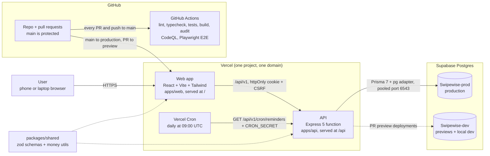
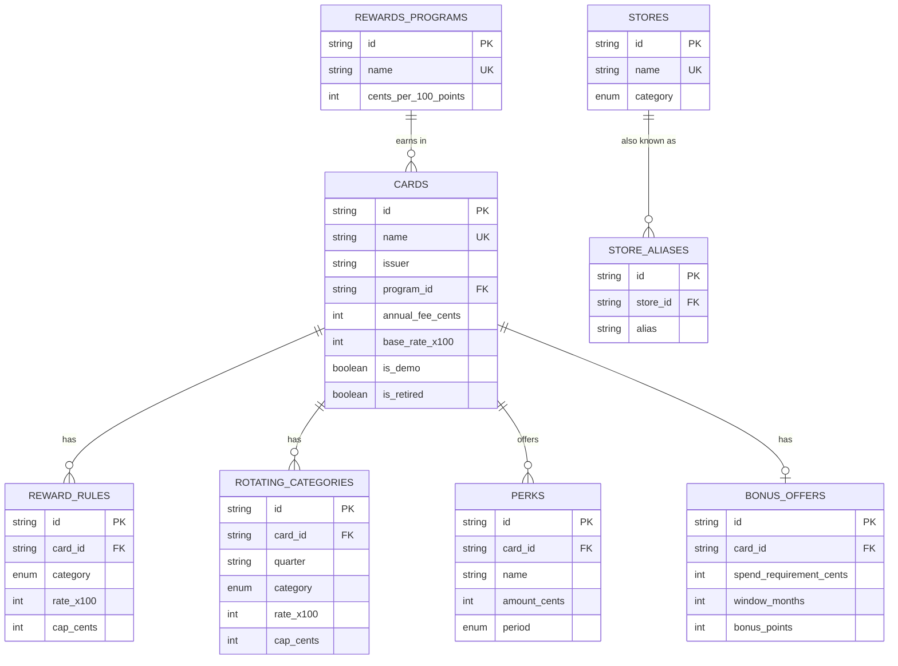
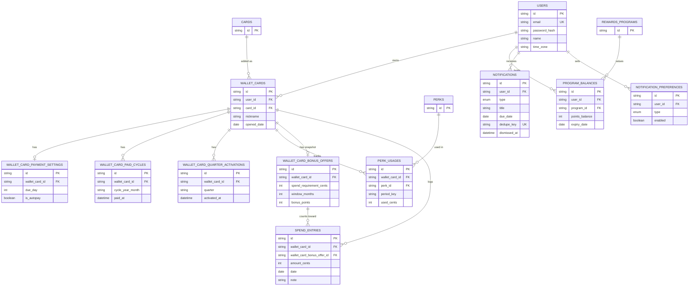

# SwipeWise architecture

## System architecture

**Key decisions**

- **One Vercel project, one domain.** The website is served at `/` and the Express API at `/api`, so the login cookie (httpOnly, Secure, SameSite=Lax) works without cross-site setup.
- **Two databases.** Production uses Swipewise-prod. Every PR preview and local development use Swipewise-dev, so a test PR can never touch real data.
- **Migrations.** Production runs `prisma migrate deploy` only when `main` deploys. Previews never migrate. Dev migrations are applied by hand after pinging the partner.
- **Server-side rules.** All rewards math and date rules run on the API, in whole cents, in the user's time zone. Shared zod schemas validate the same input on the web and the API.
- **Reminders.** Vercel Cron calls the reminder job once a day. Each reminder type is a generator in one registry, and a unique dedupe key per reminder makes re-runs safe.
- **Quality gates.** Every PR runs lint, typecheck, unit and integration tests, build, a production `npm audit`, CodeQL, and Playwright end-to-end tests against a temporary Postgres. `main` requires a PR, one approval, and green checks.

## Database

All tables also have `created_at` and `updated_at`. Money is stored as whole cents (`*_cents`), and rates as `rate_x100` (points per dollar × 100).

### Card catalog

### User data

**Notes**

- Deleting a user removes their wallet and all user data (cascade). A catalog card can't be deleted while it's in someone's wallet (restrict); it's retired instead.
- Unique keys stop duplicates: one reward rule per card and category, one activation per wallet card and quarter, one paid cycle per wallet card and month, one perk usage per wallet card, perk, and period, one balance per user and program, and one notification per dedupe key.
- `wallet_card_bonus_offers` is a copy of the card's bonus offer taken when the card is added, so later catalog changes don't change a user's deadline.
- `rate_limits` (key, total_hits, reset_time) stores login rate-limit counts in Postgres, because Vercel functions don't share memory. It isn't linked to other tables.
